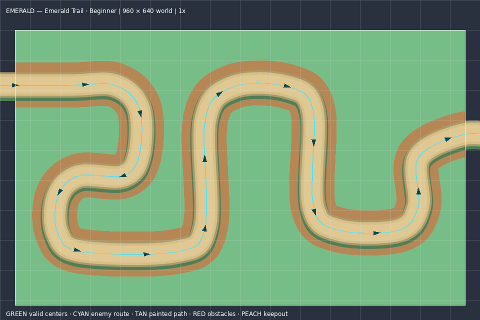
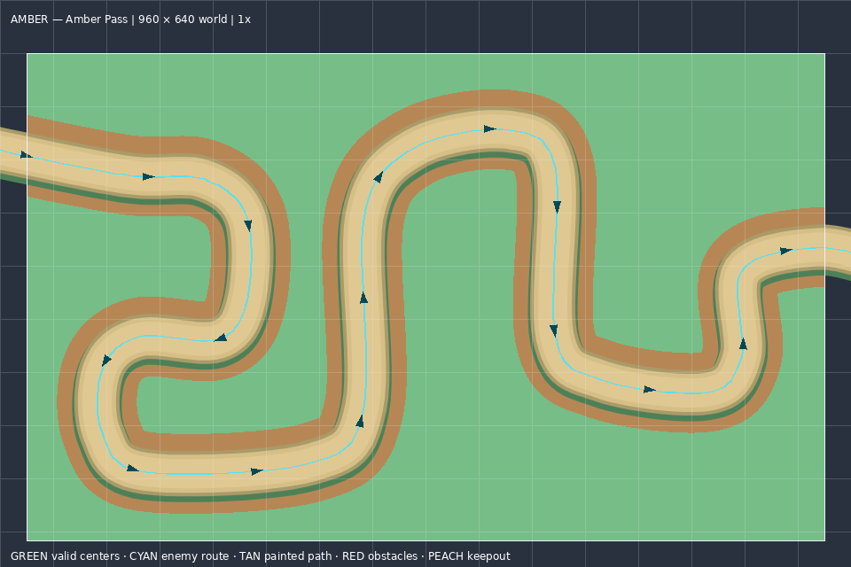
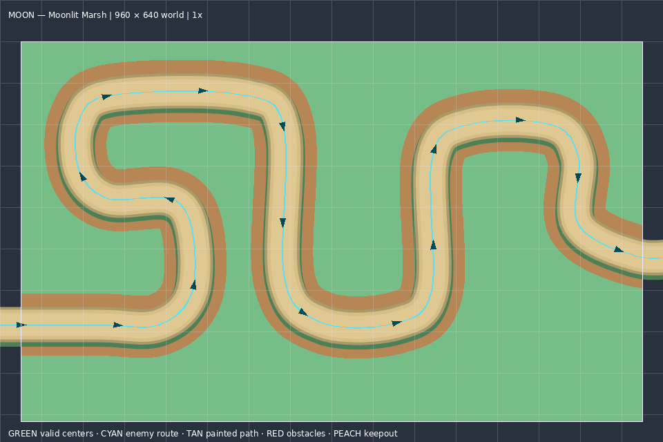
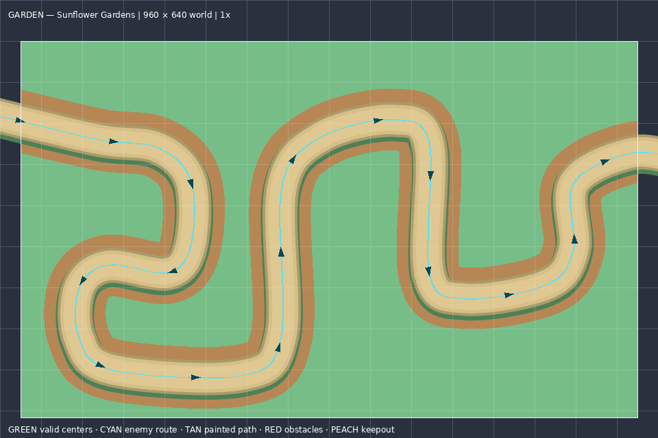
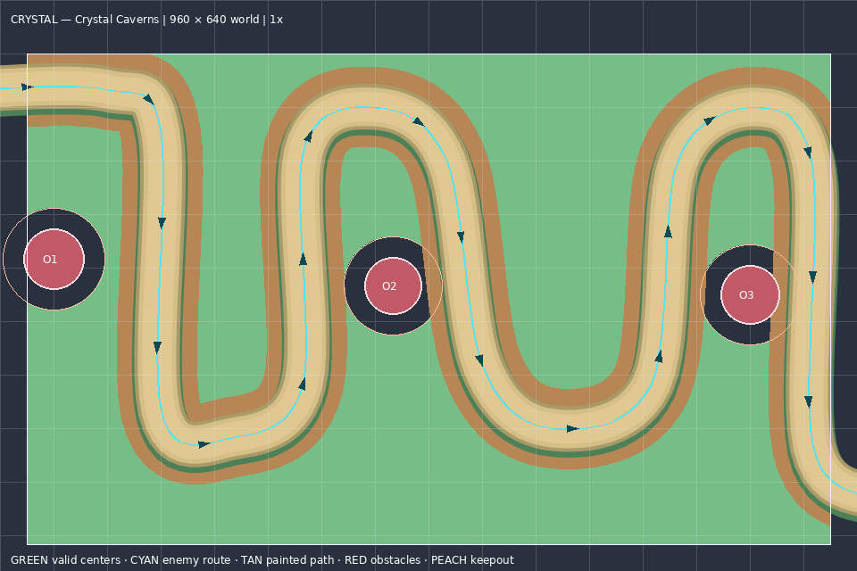
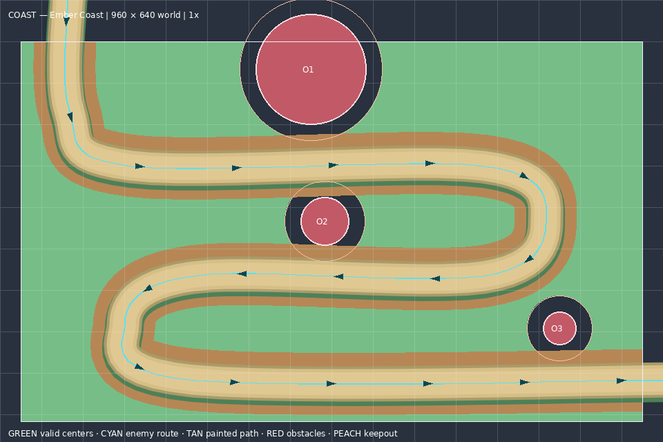

# V5 map-art geometry references

[Offline HTML preview gallery](gallery.html) · [Reusable map-art specification](MAP_ART_SPEC.md) · [Exact sampled geometry](geometry.json) · [Export manifest](manifest.json)

All maps retain their existing geometry. Green means a geometry-valid **first tower center**, not a complete sprite footprint. Cyan follows the exact sampled enemy route. Tan shows actual Phaser painted path coverage, red marks collision obstacles, and peach rings show their tower-radius clearance. The PNGs are exact 960×640 or 1920×1280 canvases with no added margin.

| Map ID | 960×640 guide | 1920×1280 production reference |
| --- | --- | --- |
| classic | [960 PNG](classic-guide-960x640.png) | [1920 PNG](classic-guide-1920x1280.png) |
| emerald | [960 PNG](emerald-guide-960x640.png) | [1920 PNG](emerald-guide-1920x1280.png) |
| amber | [960 PNG](amber-guide-960x640.png) | [1920 PNG](amber-guide-1920x1280.png) |
| moon | [960 PNG](moon-guide-960x640.png) | [1920 PNG](moon-guide-1920x1280.png) |
| garden | [960 PNG](garden-guide-960x640.png) | [1920 PNG](garden-guide-1920x1280.png) |
| crystal | [960 PNG](crystal-guide-960x640.png) | [1920 PNG](crystal-guide-1920x1280.png) |
| coast | [960 PNG](coast-guide-960x640.png) | [1920 PNG](coast-guide-1920x1280.png) |

Classic and Emerald currently share the same route. There are seven map IDs, not seven unique geometries. Empty-map valid-center masks exclude only the rules in `Game.canPlace`; decorative ponds and trees are not invented obstacles. Tower-to-tower spacing, gold, unlocks, pause and capacity are dynamic conditions outside these static terrain masks.

## Provenance and verification

Generated from existing main source commit `29ee7a856d1b3e1ce57d97721c5a28a0088eb079`. No map, placement, rendering or other runtime file was modified. Regeneration uses `node scripts/export-map-art-guides.js`; independent package validation uses `node scripts/verify-map-art-guides.js`.

Validation passed: seven exact sampled route/segment arrays and obstacle lists; source-file hashes; all 42 PNG dimensions/checksums; **67,830 raster-center comparisons against actual `Game.canPlace`** at both scales; all 14 annotated guide opacity checks; and all seven images in each of six gallery layer/resolution combinations. The gallery browser test serves this directory temporarily on loopback because managed Chromium blocks `file://` pages; it makes no production requests. Reference-only files do not require changing or retesting gameplay code.

## Preview gallery

### Classic

### Emerald

### Amber

### Moon

### Garden

### Crystal

### Coast

